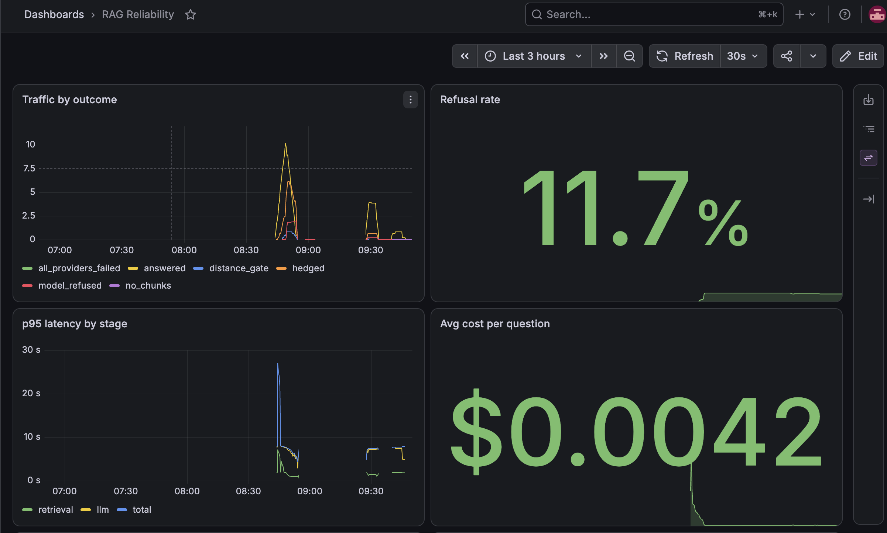
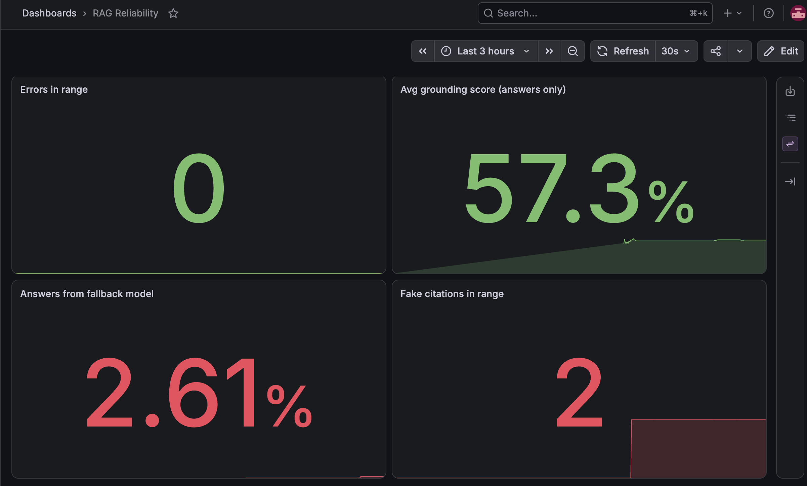

# LLM Reliability Platform

> A production RAG system over Supabase's docs where the **observability layer is the product** and the chatbot is just the workload under management.

## The Problem

LLM systems fail differently from normal software. A crashed server announces itself — but a hallucinated answer looks identical to a correct one: same confident tone, same speed, zero errors in the logs. Cost drifts upward token by token with no alarm. Latency degrades somewhere across retrieval, reranking, and generation, with no single place to look.

Most teams ship the chatbot first and bolt on logging later, so they discover failures from angry users. **This project inverts that.** The observability layer — hallucination rate, cost per query, latency breakdown, retrieval quality, and eval gates that block bad deploys — is built as the product. A RAG assistant over Supabase's documentation is simply the workload being monitored.

## Why This Project

This is the LLM-reliability counterpart to a classical MLOps pipeline: proving that production language-model systems can be kept **alive, observable, and trustworthy** — not just demoed once and abandoned.

## Target Architecture

| Layer | Choice | Why |
|-------|--------|-----|
| LLM access | Claude (Haiku default) + OpenAI fallback via LiteLLM | Multi-provider = no single point of failure |
| Vector store | Postgres + pgvector | One boring, proven DB — fewer moving parts |
| Retrieval | Hybrid (BM25 + vector) with weighted RRF | Keywords catch exact terms vectors miss |
| Orchestration | LangGraph | Explicit, debuggable state machine |
| Observability | OpenTelemetry → Langfuse + Prometheus/Grafana | Instrument once, swap vendors freely |
| Evaluation | Hand-built golden dataset + retrieval and end-to-end evals | Every change is measurable |
| Safety | Guardrails AI | Injection + PII filtering at input and output |
| Infra | FastAPI · Docker · Cloud Run · GitHub Actions · Terraform | Reused, battle-tested stack |

## Progress

Built in public, one phase at a time. Each phase ships a version tag.

| Phase | Focus | Status |
|-------|-------|--------|
| 0 | Foundation — repo, env, funded keys, smoke test | ✅ `v0.0` |
| 1 | Document ingestion — clean, chunk, embed, store | ✅ `v1.0` |
| 2 | Basic RAG — retrieve + cited answers | ✅ `v1.1` |
| 3 | Retrieval quality — hybrid search + diversity | ✅ `v1.2` |
| 4 | Golden dataset — 120 hand-written questions | ✅ `v1.3` |
| 5 | Eval pipeline — measurement fixed, settings tuned | ✅ `v1.4` |
| 6 | Observability — tracing, metrics, dashboards, grounding score | ✅ `v1.5` |
| 7 | Orchestration — LangGraph | ⬜ |
| 8 | Safety — Guardrails | ⬜ |
| 9 | Fine-tuning — RAG vs fine-tune comparison | ⬜ |
| 10 | Production deploy — CI/CD with eval gates | ⬜ |
| 11 | Storytelling — incident log, blog, launch | ⬜ |

## What it looks like

Every query is traced to Langfuse; every metric is collected by Prometheus and drawn in Grafana. The dashboard below is provisioned from this repo — delete Grafana entirely and it rebuilds itself.



*Traffic by outcome, refusal rate, p95 latency split by stage, and average cost per question, during a replay of the 120-question golden set. Note the latency panel: the LLM line sits almost on top of the total — retrieval is about a second, generation is the rest.*



*The quality row. The two red panels are honest: **fallback 2.61%** is a deliberate test — the server was run with a broken primary API key to prove the panel turns red ([INC-013](./INCIDENTS.md)). **Fake citations: 2** are false alarms from a bug in the checker itself, which read `files[0]` in JavaScript samples as a citation; fixed, and kept on screen because it happened ([INC-012](./INCIDENTS.md)).*

## Current results (`v1.5`)

Measured against 120 hand-written questions. Full detail in [`eval/REPORT.md`](./eval/REPORT.md).

| Metric | Result |
|---|---|
| Unanswerable questions correctly declined | **35 / 35** |
| Hallucinated answers | **0** |
| Answerable questions answered (end to end) | **58 / 65** |
| Retrieval: expected document in top 5 | **70 / 85** |
| Retrieval: bare tokens found (`aal2`, `42501`, ...) | **20 / 20** |
| Hedge rate — declined, then explained what *is* documented | 26 / 100 |
| Grounding — share of claim sentences carrying a source | **58%** baseline |
| Cost per question | **$0.0040** |

> **Correction.** An earlier version of this README reported 49% refusal accuracy. That number was a measurement error, not a system failure: every one of the 18 "wrongly answered" questions had actually opened with the refusal sentence and then added a line about what the documentation did cover. The detector counted any refusal longer than ~190 characters as a failure. The real figure on the same run was 35 / 35. See [INC-008](./INCIDENTS.md).

## Data Pipeline (Phase 1 — `v1.0`)

```
811 source .mdx → 792 clean docs → 2,654 chunks → 2,654 embeddings → Postgres
```

- **Source:** `apps/docs/content` from the [supabase/supabase](https://github.com/supabase/supabase) monorepo, pinned to commit `5b68af17` — the corpus is reproducible, not scraped
- **Cleaning:** custom MDX preprocessor — strips component tags, protects code blocks, extracts metadata, filters nav-only pages
- **Chunking:** 500-token sliding window, 75-token (15%) overlap, 100-token floor for trailing slices
- **Metadata:** every chunk carries title, source path, doc type, and a resolvable docs URL for citation
- **Embeddings:** `text-embedding-3-small` (1536d), batched 100/call, resumable, ~$0.023 for the full corpus
- **Storage:** Postgres 16 + pgvector in Docker; idempotent upsert on `chunk_id`

## RAG Pipeline (Phase 2 — `v1.1`)

Retrieved chunks are grounded into cited answers, with refusal treated as correct behaviour rather than failure.

```
question → retrieve top-5 → distance gate → grounded prompt → cited answer
                                  |
                                  +-- distance > 0.65: refuse, zero cost
```

- **Grounding:** the system prompt permits answers only from retrieved context, requires a citation on every claim, and specifies an exact refusal sentence — a fixed string is machine-detectable, which makes refusal rate a metric rather than a hope
- **Calibrated refusal:** when the best retrieval distance exceeds 0.65, the query is refused **before the LLM is called** — a cheap deterministic signal gating an expensive stochastic one
- **Provider failover:** all calls route through LiteLLM; a primary-provider failure falls back automatically. A single provider is a single point of failure
- **Telemetry from day one:** every query logs cost, token counts, retrieval-vs-generation latency split, best distance, and refusal reason to JSONL

### Refusal categories

| Reason | Meaning |
|---|---|
| `distance_gate` | Retrieval too weak — refused before generation |
| `model_refused` | Retrieval acceptable, but the model judged the context insufficient |
| `no_chunks` | Search returned nothing |
| `all_providers_failed` | Infrastructure failure, not a knowledge gap |

A `hedged` flag additionally marks responses that decline and then explain what the documentation does cover. Hedges count as correct declines but are tracked separately: a hedge is good behaviour, and also the shape hallucination would take if it appeared.

## Retrieval Quality (Phase 3 — `v1.2`)

Semantic search alone has a specific blind spot: it blurs exact tokens. Error codes, function names and config keys carry little learned meaning, so they map to a generic "technical identifier" region where every error code looks alike.

```
question --+-- vector search (top 10) --+
           |                            +-- weighted RRF -> diversity cap -> top 5
           +-- BM25 search   (top 10) --+
```

- **Hybrid retrieval:** vector search handles paraphrase and intent; BM25 handles exact tokens. They fail in opposite directions, so fusing them covers both
- **Weighted RRF:** rankings are fused by position, not score — cosine distance and BM25 scores aren't comparable, and normalising means choosing an arbitrary mapping that biases one retriever
- **Diversity cap:** at most 2 chunks per document. Queries routinely returned 3–4 chunks from one source, so five slots carried a single document's worth of evidence

### Measured: the exact-token case

Searching the error code `PGRST116`:

| Retriever | Behaviour |
|---|---|
| BM25 | Correct doc scored **7.47**; every other chunk scored **0.00** |
| Vector | Correct doc first at **0.539**, but a *different* error code (PGRST106) at **0.652** — only 0.11 separating right from wrong |
| Hybrid | Correct doc first, at **2× the score** of anything else, because both retrievers agreed |

### Built, measured, and not shipped

| Change | Result | Decision |
|---|---|---|
| Cross-encoder reranker | Ranked the PGRST106 page above the page containing PGRST116; added ~5s per query against a 4.8s baseline | Not shipped — [DEC-014](./DECISIONS.md) |
| Document-type boost for problem queries | Promoted a chunk both retrievers ranked poorly to first, pushing the canonical guide out of the top five | Built but disabled — [DEC-015](./DECISIONS.md) |

## Golden Dataset (Phase 4 — `v1.3`)

120 question/answer pairs, written by hand against the real corpus. No LLM generation — an auto-generated set only tests whether the system agrees with another model.

| Category | Count | What it tests | Scored on |
|---|---:|---|---|
| `simple_lookup` | 40 | Basic retrieval and citation | Retrieval + answer |
| `multi_step` | 25 | Whether multiple relevant chunks are assembled | Retrieval + answer |
| `exact_token` | 20 | Bare strings (`aal2`, `42501`, `maybeSingle()`) | Retrieval only |
| `unanswerable` | 35 | Calibrated refusal — the project's core claim | Answer only |

Unanswerable questions are 29% of the set deliberately. A set that is 95% answerable can score well while refusing nothing correctly.

**Known weaknesses in the dataset itself:**
- Most unanswerable questions use absolute phrasing — "exact", "guaranteed", "confidential" — which makes them *easy* refusals. The hard ones are mild and ordinary. A future revision should weight toward those.
- Expected-source labels were written by hand and two were found to be wrong in Phase 5. Some remaining retrieval misses are likely label errors.

## Evaluation (Phase 5 — `v1.4`)

Most of this phase was fixing the yardstick, not the system. Three of the four changes were to measurement; one was to the pipeline.

### The measurement was wrong

| Problem | Effect | Fix |
|---|---|---|
| Refusal detector required responses under ~190 characters | 18 correct refusals scored as hallucinations | Hedges count as declines, tracked separately |
| Bare tokens scored on their answers | A bare string isn't a question — the model correctly asks for clarification | Bare tokens scored on retrieval only |
| Bare tokens required one specific expected file | Most tokens appear in several docs, so correct retrievals counted as misses | Scored on whether any retrieved chunk contains the token |
| Two expected-source labels were wrong | Real retrievals marked as failures | Corrected after grepping the corpus |

### The one pipeline change

A retrieval-only eval — no LLM calls, deterministic, and nearly free — swept the BM25 weight:

| BM25 weight | 0.0 (vector only) | 0.5 (previous) | **1.0** | 1.5 | 2.0 |
|---|---|---|---|---|---|
| Expected doc in top 5 | 63 / 85 | 65 / 85 | **70 / 85** | 63 / 85 | 63 / 85 |

1.0 was best in every category. Hybrid retrieval is worth **+7** correct documents over vector search alone — the first measured confirmation that Phase 3 was worth building. Above 1.0, keyword matches displace good semantic results. A full end-to-end run confirmed the change: answerable 57 → 58, unanswerable held at 35 / 35.

### Tried and reverted

Bare tokens score high cosine distance (no sentence context), so the refusal gate blocks them. Letting a strong BM25 score override the gate failed: "pizza" scores 13.47 against the PostGIS guide, which uses a restaurant example dataset. **Keyword presence is not evidence of answerability.** Reverted — [OBS-004](./INCIDENTS.md).

## Observability (Phase 6 — `v1.5`)

The point of the project. Two layers, because they answer different questions:

```
Langfuse    one query in depth    "why did THIS answer cost $0.006 and take 9 seconds?"
Prometheus  all queries over time "what is p95 latency this hour? how often do we refuse?"
Grafana     draws Prometheus as a dashboard
```

```
FastAPI /ask ──trace──> Langfuse Cloud           (OpenTelemetry under the SDK)
     │
     └── /metrics <──every 5s── Prometheus ──> Grafana   (both in docker compose)
```

### Tracing

Each query is one Langfuse trace: a `retrieval` span recording every chunk's distance and keyword score, and an `llm-call` generation recording model, tokens and cost. Gated refusals have no generation at all — visible proof no money was spent on them. Every exit path writes its outcome onto the trace, so no trace is left without one. The Langfuse SDK is built on OpenTelemetry, so the backend is swappable.

Within three test queries the retrieval spans exposed a problem the eval had missed: two irrelevant keyword-only results in a top five ([OBS-005](./INCIDENTS.md)).

### Metrics

| Metric | Type | Labels |
|---|---|---|
| `rag_requests_total` | counter | `outcome` |
| `rag_errors_total` | counter | — |
| `rag_cost_usd_total`, `rag_tokens_total` | counters | token `type` |
| `rag_llm_calls_total` | counter | `model` |
| `rag_fake_citations_total` | counter | — |
| `rag_retrieval_seconds`, `rag_llm_seconds`, `rag_total_seconds` | histograms | — |
| `rag_grounding_score` | histogram | — |

- **Labels come from small fixed sets — never the question text.** Unbounded label values create a new time series per question
- **Errors are separate from refusals.** A refusal is correct behaviour; an error means something broke
- **LLM latency is only recorded when the model is called**, so gated refusals don't make the model look faster than it is
- **Every label is created at zero on startup.** Prometheus measures change; a counter born at 1 shows no increase, so the first fallback was invisible until this was fixed ([INC-013](./INCIDENTS.md))

**Cost per query agrees across four independent sources** — Langfuse traces, JSONL logs, the eval runner and Prometheus — to the fourth decimal place.

### Grounding score — a quality signal on every answer

The prompt requires a source on every claim, so every answer is scored on **what share of its claim sentences carry one**, and on any citation pointing at a source that doesn't exist. It is free, instant and runs on 100% of traffic.

It is a **warning light, not proof**: a sentence can carry `[1]` while `[1]` doesn't say that. An LLM judge on a sample is the next layer; running one on every query would double cost for the same trend line.

**Baseline: 58%** of claim sentences sourced across the golden set. Good answers land around 60–100% — the check is strict, and the model sometimes sources a pair of sentences once.

**It caught a real incident on its first run.** The primary model's API key expired; the fallback took over and every request still succeeded with normal latency. But grounding on the same question fell from **62% to 25%** — the fallback model cited once per paragraph instead of once per claim. **Failover protected uptime, not quality** ([INC-011](./INCIDENTS.md)).

### Dashboard as code

| # | Panel | Red when |
|---|---|---|
| 1 | Traffic by outcome | — |
| 2 | Refusal rate | — |
| 3 | p95 latency by stage | — |
| 4 | Average cost per question | — |
| 5 | Spend in range | — |
| 6 | Hedge rate | — |
| 7 | Errors | any |
| 8 | Average grounding score | below 40% |
| 9 | Answers from fallback model | any |
| 10 | Fake citations | any |

The data source and dashboard are provisioning files in `monitoring/grafana/`, with a fixed data-source ID so panels never lose their connection. Grafana 13 exports a newer dashboard format by default; the dashboard is written in the classic format that file provisioning reliably loads. **Reproducibility was proven by deletion:** removing the Grafana container and its storage, then starting it again, rebuilt the full dashboard from the repo.

**Every red panel was tested by switching it on** — the fallback panel by running the server with a deliberately broken API key.

### What the dashboard showed that wasn't known before

**Latency is almost entirely generation.** Retrieval is about a second; the LLM is the other six to eight. Making the system faster means fewer chunks, shorter answers or streaming — optimising retrieval would barely move the number.

## Engineering log

Thirteen incidents and five observations are recorded across Phases 1–6. Almost every one surfaced by cross-checking numbers rather than by an error message — and four of them were bugs in the measurement itself: two in the evaluation, two in the monitoring. See [`INCIDENTS.md`](./INCIDENTS.md) and [`DECISIONS.md`](./DECISIONS.md).

## Setup

```bash
# Clone and enter
git clone https://github.com/5Malav/llm-reliability-platform.git
cd llm-reliability-platform

# Python 3.11.9 (pinned via .python-version)
python3 -m venv venv
source venv/bin/activate
pip install -r requirements.txt

# Configure secrets
cp .env.example .env
# fill in ANTHROPIC_API_KEY, OPENAI_API_KEY, DATABASE_URL,
# LANGFUSE_PUBLIC_KEY, LANGFUSE_SECRET_KEY, LANGFUSE_BASE_URL

# Start Postgres, Prometheus and Grafana
docker compose up -d
docker compose exec -T db psql -U postgres -d llm_reliability < ingestion/schema.sql

# Build the corpus
python -m ingestion.clean_docs
python -m ingestion.chunk_docs
python -m ingestion.embed_chunks
python -m ingestion.load_to_db

# Ask a question from the command line
python -m api.rag "how do I set up GitHub authentication?"

# Or run the API — Prometheus scrapes it, Grafana shows it
uvicorn api.server:app --host 0.0.0.0 --port 8000
curl -X POST localhost:8000/ask -H "Content-Type: application/json" \
     -d '{"question": "how do I set up GitHub authentication?"}'
# Grafana:    http://localhost:3000   (admin / admin)  → RAG Reliability
# Prometheus: http://localhost:9090
python -m eval.replay_api           # send the 120 golden questions through the API

# Inspect retrieval on its own
python -m retrieval.hybrid_search "PGRST116"

# Evaluate
python -m eval.validate_dataset     # dataset integrity
python -m eval.retrieval_eval       # retrieval sweep — free, ~7 min
python -m eval.run_golden           # full end-to-end run — ~$0.50, ~8 min
python -m eval.summarize            # end-to-end results
```